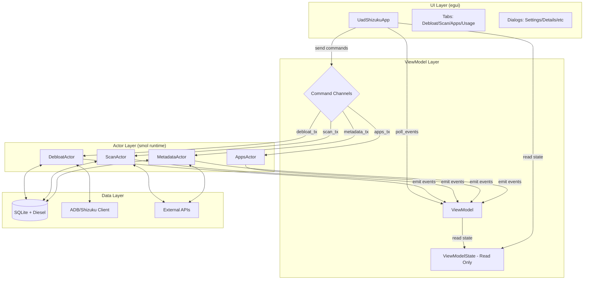

# UAD-Shizuku Architecture

Cross-platform Android device management tool using MVVM with actor-based concurrency.
Built with egui UI, smol async runtime, Diesel + SQLite database.

**Primary Functions**: debloat bloatware, scan malware, install FOSS apps, metadata enrichment
**Platforms**: Desktop (Windows/macOS/Linux), Android native, WASM (experimental)
**Core Pattern**: MVVM with reactive state + background actors

---

## Application Interface

```sudo
UadShizukuApp {
  // Core components
  viewmodel: ViewModel
  shared_store: SharedStore  // LEGACY: texture cache only
  
  // UI tabs
  tabs: [debloat, scan, apps, usage]
  active_tab: TabId
  
  // Dialogs
  dialogs: {
    about, settings, package_details, uninstall_confirm,
    adb_install, update, mobile_scan, mobile_risk
  }
  
  // Platform detection
  platform = detect_platform()  // Desktop | Android | WASM
  
  constraints {
    * UI always reads from viewmodel.state (never writes directly)
    * UI sends commands via viewmodel command channels
    * UI polls viewmodel.poll_events() every frame to get actor updates
    * Texture/image caching remains in SharedStore (egui constraint)
  }
}
```

---

## MVVM Architecture



---

## ViewModel Interface

```sudo
ViewModel {
  // Command channels (UI → Actors)
  debloat_tx: Channel<DebloatCommand>
  scan_tx: Channel<ScanCommand>
  apps_tx: Channel<AppsCommand>
  metadata_tx: Channel<MetadataCommand>
  
  // Event channel (Actors → UI)
  event_rx: Channel<ViewModelEvent>
  
  // Public state (read-only from UI)
  state: ViewModelState {
    // Debloat domain
    packages: Vec<PackageFingerprint>
    uad_ng_lists: UadNgLists
    filtered_packages: Vec<PackageFingerprint>
    
    // Scanner states
    vt_scanner_state: ScannerState  // VirusTotal
    ha_scanner_state: ScannerState  // HybridAnalysis
    stalkerware_indicators: StalkerwareIndicators
    
    // Metadata cache
    cached_metadata: MetadataCache {
      google_play: HashMap<PackageId, GooglePlayApp>
      fdroid: HashMap<PackageId, FDroidApp>
      apkmirror: HashMap<PackageId, ApkMirrorApp>
      android_package: HashMap<PackageId, AndroidPackageInfo>
    }
    
    // Progress tracking
    active_operations: HashMap<OperationId, OperationProgress>
  }
  
  // Runtime handle
  _runtime_handle: JoinHandle<()>
  
  // Methods
  fn new(ctx: egui::Context) {
    * Create command/event channels
    * Spawn smol runtime in background thread
    * Spawn all 4 actors
    * Initialize state
  }
  
  fn send_debloat_command(cmd)
  fn send_scan_command(cmd)
  fn send_apps_command(cmd)
  fn send_metadata_command(cmd)
  
  fn poll_events() {
    * Non-blocking receive from event_rx
    * Update state based on events
    * Return events to UI for display
  }
  
  constraints {
    * State is single source of truth
    * Only actors mutate state (via events)
    * UI never writes to state directly
    * All async work happens in actors
  }
}
```

---

## Actor Pattern

```sudo
interface Actor {
  name: String
  command_rx: Channel<Command>
  event_tx: Channel<ViewModelEvent>
  
  async fn run() {
    loop {
      match command_rx.recv().await {
        case cmd => {
          result = handle_command(cmd).await
          event_tx.send(Event::from(result)).await
        }
      }
    }
  }
  
  constraints {
    * Each actor runs in smol task
    * Actors communicate only via channels
    * Actors own their domain logic
    * Actors emit events for all state changes
  }
}

// Four concrete actors

DebloatActor : Actor {
  commands {
    LoadPackages(user_id)
    LoadUadLists
    UninstallPackage(package_id)
    DisablePackage(package_id)
    RestorePackage(package_id)
  }
  
  events {
    PackagesLoaded(Vec<PackageFingerprint>)
    UadListsLoaded(UadNgLists)
    OperationComplete(result)
    Error(error)
  }
  
  * Interacts with ADB/Shizuku for package operations
  * Loads UAD-NG debloat lists (embedded resource)
}

ScanActor : Actor {
  commands {
    ScanPackage { package_id, scanner_type }
    LoadStalkerwareIndicators
  }
  
  scanner_type = VirusTotal | HybridAnalysis
  
  events {
    ScanProgress { package_id, progress }
    ScanComplete { package_id, result }
    StalkerwareIndicatorsLoaded(indicators)
    Error(error)
  }
  
  * Queries VirusTotal/HybridAnalysis APIs
  * Caches results in database
  * Loads stalkerware IoC indicators (embedded resource)
  * Updates scanner state (rate limits, quota)
}

AppsActor : Actor {
  commands {
    LoadFossList
    InstallApp(app_id)
    SearchApps(query)
  }
  
  events {
    FossListLoaded(Vec<FossApp>)
    InstallQueued(app_id)
    SearchResults(Vec<FossApp>)
  }
  
  * Manages FOSS app installation queue
  * Fetches from curated lists
}

MetadataActor : Actor {
  commands {
    FetchGooglePlay(package_id)
    FetchFDroid(package_id)
    FetchApkMirror(package_id)
    FetchAndroidPackage(package_id)
  }
  
  events {
    MetadataFetched { source, package_id, metadata }
    CacheUpdated
    Error(error)
  }
  
  * Scrapes Google Play, F-Droid, APKMirror
  * Caches metadata in database
  * Updates ViewModelState.cached_metadata
}
```

---

## Database Layer

```sudo
Database {
  engine = "SQLite 3"
  orm = "Diesel"
  migrations = embedded  // Auto-run on startup
  
  tables {
    virustotal_results {
      package_id: String (PK)
      scan_date: Timestamp
      positives: i32
      total: i32
      scan_id: String
      permalink: String
      cached_at: Timestamp
    }
    
    hybridanalysis_results {
      sha256: String (PK)
      verdict: String
      threat_score: i32
      analysis_date: Timestamp
      report_url: String
      cached_at: Timestamp
    }
    
    package_info_cache {
      package_id: String (PK)
      name: String
      version: String
      system_app: Boolean
      has_apk: Boolean
      cached_at: Timestamp
    }
    
    google_play_apps {
      package_id: String (PK)
      title: String
      developer: String
      rating: f32
      installs: String
      icon_url: String
      cached_at: Timestamp
    }
    
    fdroid_apps {
      package_id: String (PK)
      name: String
      summary: String
      license: String
      categories: JSON
      cached_at: Timestamp
    }
    
    apkmirror_apps {
      package_id: String (PK)
      app_name: String
      latest_version: String
      download_url: String
      cached_at: Timestamp
    }
  }
  
  constraints {
    * Schema auto-generated by Diesel (schema.rs)
    * Never edit schema.rs manually
    * Add migrations with: diesel migration generate <name>
    * Database path set at app startup from Config
  }
  
  paths {
    desktop_linux = "~/.config/uad_shizuku/dbs/uad.db"
    desktop_macos = "~/.config/uad_shizuku/dbs/uad.db"
    desktop_windows = "%APPDATA%/uad_shizuku/dbs/uad.db"
    android = "/data/data/pe.nikescar.uad_shizuku/dbs/uad.db"
  }
}
```

---

## External Resources

```sudo
ExternalResources {
  // Downloaded at build time by build.rs
  
  uad_lists {
    source = "https://github.com/0x192/universal-android-debloater"
    file = "mobile/resources/uad_lists.json"
    format = JSON
    content = "Debloat safety ratings and removal recommendations"
    * Embedded in binary via include_str!
  }
  
  stalkerware_indicators {
    source = "https://github.com/AssoEchap/stalkerware-indicators"
    file = "mobile/resources/stalkerware_ioc.yaml"
    format = YAML
    content = "Indicators of Compromise for stalkerware detection"
    * Embedded in binary via include_str!
  }
  
  constraints {
    * Resources downloaded during cargo build
    * To force update: rm resources/*.{json,yaml} && cargo clean && cargo build
  }
}
```

---

## Module Organization

```sudo
CodebaseStructure {
  // Entry points
  entry_desktop = "mobile/src/main.rs"
  entry_android = "mobile/src/main_android.rs"
  entry_lib = "mobile/src/lib.rs"
  
  // Core app
  app = "mobile/src/uad_shizuku_app.rs"  // Main egui app struct
  
  // MVVM layer (NEW - June 2026)
  viewmodel {
    mod = "mobile/src/viewmodel/mod.rs"
    debloat = "mobile/src/viewmodel/debloat.rs"
    scan = "mobile/src/viewmodel/scan.rs"
    apps = "mobile/src/viewmodel/apps.rs"
    metadata = "mobile/src/viewmodel/metadata.rs"
    common = "mobile/src/viewmodel/common.rs"  // Events, types
  }
  
  // UI components
  tabs = ["tab_debloat.rs", "tab_scan_control.rs", "tab_apps_control.rs", "tab_usage_control.rs"]
  dialogs = ["dlg_*.rs"]  // 10+ dialog modules
  
  // Platform integration
  android = ["android_*.rs"]  // JNI, Shizuku, clipboard, etc
  adb = "adb.rs"  // Desktop ADB client
  
  // API clients
  apis = ["api_virustotal.rs", "api_hybridanalysis.rs", "api_googleplay.rs", "api_fdroid.rs", "api_apkmirror.rs"]
  
  // Business logic
  calc = ["calc.rs", "calc_*.rs"]  // Domain calculations
  
  // Database
  db = ["db.rs", "db_*.rs", "schema.rs"]  // Diesel ORM
  migrations = "mobile/migrations/"  // SQL migrations
  
  // State structs (paired with main modules)
  state = ["*_stt.rs"]  // e.g., scan_stt.rs for ScanState
  
  // Data models
  models = "models.rs"
  
  // Localization
  i18n = "mobile/assets/languages/fluent/{en-US,ko-KR}.ftl"
  
  naming_conventions {
    android_* => "Android JNI/platform modules"
    api_* => "External API clients"
    calc_* => "Business logic/calculations"
    db_* => "Database operations"
    dlg_* => "Dialog windows"
    tab_* => "UI tabs"
    *_stt => "State struct modules"
  }
  
  constraints {
    * State structs suffixed with _stt (e.g., scan_stt.rs)
    * New async work goes in viewmodel actors (not SharedStore)
    * SharedStore is LEGACY, only for texture caching
  }
}
```

---

## Data Flow Pattern

```sudo
DataFlow {
  // User interaction flow
  user_action |>
  ui_component |>
  viewmodel.send_command |>
  actor.handle_command |>
  [database | adb | api] |>
  actor.emit_event |>
  viewmodel.poll_events |>
  viewmodel.state_update |>
  ui_reads_state |>
  ui_repaint
  
  // Example: Scan package
  flow scan_package(package_id) {
    // 1. User clicks "Scan" button
    ui: tab_scan_control.rs::on_scan_clicked(package_id)
    
    // 2. UI sends command
    viewmodel.send_scan_command(ScanCommand::ScanPackage {
      package_id,
      scanner_type: VirusTotal
    })
    
    // 3. Actor receives and processes
    actor: scan_actor.handle_command() {
      * Check database cache first
      * If not cached: call VirusTotal API
      * Parse response
      * Store in database
      * Emit ScanComplete event
    }
    
    // 4. ViewModel polls events
    viewmodel.poll_events() {
      * Receive ScanComplete event
      * Update state.vt_scanner_state
      * Update state.cached_metadata
    }
    
    // 5. UI reads updated state
    ui: tab_scan_control.rs::update() {
      * Read viewmodel.state.vt_scanner_state
      * Display results
      * Trigger repaint
    }
  }
  
  constraints {
    * Never bypass the channel pattern
    * Never mutate state from UI
    * Always emit events for state changes
    * Always poll events in UI update loop
  }
}
```

---

## Platform Variants

```sudo
Platforms {
  Desktop {
    os = Windows | macOS | Linux
    entry = "mobile/src/main.rs"
    adb = "Requires adb in PATH or bundled"
    window = "Native OS windowing (GTK/Win32/Cocoa)"
    
    constraints {
      * ADB client must be available
      * Settings path: ~/.config/uad_shizuku/settings.txt
      * Database path: ~/.config/uad_shizuku/dbs/
    }
  }
  
  Android {
    entry = "mobile/src/main_android.rs"
    adb_alternative = "Shizuku JNI for native execution"
    permissions = "Requires Shizuku permission grant"
    
    constraints {
      * No ADB needed (uses Shizuku instead)
      * Settings path: /data/data/pe.nikescar.uad_shizuku/files/settings.txt
      * Database path: /data/data/pe.nikescar.uad_shizuku/dbs/
      * Lifecycle handling needs improvement (freezes after sleep)
    }
  }
  
  WASM {
    target = "wasm32-unknown-unknown"
    status = "Experimental, not production-ready"
    limitations = ["No ADB support", "Diesel uses WASM SQLite VFS"]
    
    constraints {
      * Partially implemented
      * Not recommended for production
    }
  }
}
```

---

## Configuration & Settings

```sudo
Settings {
  format = "Plain text key-value pairs"
  persistence = Config.settings_file_path()
  
  keys {
    virustotal_api_key: String  // Required for malware scanning
    hybridanalysis_api_key: String  // Required for sandbox analysis
    language: String  // en-US | ko-KR
    theme: String  // green | lightblue | lightpink | yellow
    contrast: String  // standard | medium | high
  }
  
  api_limits {
    virustotal_free = "4 requests/min"
    hybridanalysis_free = "200 requests/min"
  }
  
  constraints {
    * Settings loaded at app startup
    * API keys required for full functionality
    * Invalid API keys fail gracefully (disable features)
  }
}
```

---

## Migration Status (June 2026)

```sudo
MigrationStatus {
  completed {
    ✅ Migrated from SharedStore singleton to MVVM
    ✅ Implemented 4 actors (Debloat, Scan, Apps, Metadata)
    ✅ Centralized state in ViewModelState
    ✅ Added integration tests for actors
    ✅ Scanner states moved to ViewModel
    ✅ Metadata cache moved to ViewModel
    ✅ Stalkerware indicators loaded into ViewModel
  }
  
  legacy {
    * SharedStore still exists for texture caches (egui constraint)
    * Some old modules reference SharedStore (being phased out)
  }
  
  guidance {
    * New code MUST use ViewModel pattern
    * Never add new dependencies to SharedStore
    * All async operations MUST use actors
  }
  
  documentation = "docs/mvvm-actor-migration-complete.md"
}
```

---

## Development Commands

```sudo
commands {
  /build => cargo build
  /run => cargo run
  /test => cargo nextest run
  /test [name] => cargo nextest run $name
  /coverage => cargo llvm-cov --html
  /format => cargo fmt
  /lint => cargo clippy
  /audit => cargo audit
  /update-lists => rm mobile/resources/*.{json,yaml} && cargo clean && cargo build
  /migration [name] => cd mobile && diesel migration generate $name
}
```

---

## Known Limitations

```sudo
KnownIssues {
  critical: []
  
  high {
    * Android lifecycle handling (app freezes after sleep)
  }
  
  medium {
    * APKMirror app ID search accuracy
    * Web version blocked by Diesel/ureq WASM compatibility
    * Some metadata fetchers fail when website structure changes
  }
  
  low: []
}
```

---

## Architecture Principles

```sudo
Principles {
  constraints {
    * Single source of truth: ViewModelState
    * Unidirectional data flow: Commands down, Events up
    * Actor isolation: No shared mutable state
    * Platform abstraction: ADB for desktop, Shizuku for Android
    * Cache aggressively: Database caches all API responses
    * Fail gracefully: Missing API keys disable features, don't crash
    * Reactive UI: Poll events every frame, never block UI thread
  }
  
  anti_patterns {
    ❌ Direct state mutation from UI
    ❌ Blocking operations on UI thread
    ❌ Adding new SharedStore dependencies
    ❌ Bypassing actor channels
    ❌ Hardcoding API keys
    ❌ Using unwrap/expect in production
  }
}
```
